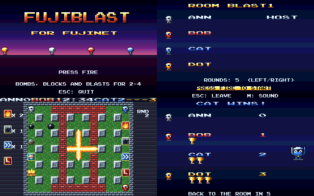

# Amiga (FujiNet NIO)

FujiBlast runs on a 68000 Amiga with OCS/ECS, 512 KB chip RAM plus 512 KB
additional RAM, and Kickstart/Workbench 1.3 or later. PAL and NTSC use a
320×200, 32-colour game screen. The client uses FujiNet NIO firmware and
[fujinet-nio-lib 0.2.0](https://github.com/fujinet-nio/fujinet-nio-lib/releases/tag/v0.2.0).
The server, game protocol, artwork and musical scores are shared with the other
clients.



## Build

Install Python 3.9+, GNU Make 4.3+ and `m68k-amigaos-gcc` with libnix's `nix13`
runtime, readable NDK headers and `libamiga`. In the NIO workspace, source
`scripts/env.sh` before building. From the game repository:

```sh
make amiga SERVER=fujinet.online:9910
```

The executable is `r2r/amiga/fujiblast-nio`. Set `AMIGA_CC` to select a compiler.
The build downloads the official `fujinet-nio-lib-amiga-0.2.0.zip`, verifies its
pinned SHA256 and caches it under `_cache/fujinet-nio-lib/amiga-0.2.0/` for
offline builds. Applications use the `amiga` library variant.

The default server is `fujinet.online:9910`. `SERVER=host:port` selects a build
default; `gen/amiga/config.h` retains that selection between builds. Saved
settings take precedence. `LOBBY_SERVER=host:port` selects the independent Lobby
preset. Addresses are resolved by the FujiNet NIO host.

## Run

Load the resident broker supplied by your NIO installation, then run the game:

```text
fujinet-load-resident DEVS:fujinet-nio.device fujinet-nio.device
Stack 32768
fujiblast-nio
```

The broker owns the connection to NIO. The game does not open the serial port.
A missing broker produces a startup error and returns to AmigaDOS. Copy the
executable to a floppy, hard disk or emulator share and boot your own Workbench;
licensed OS media are not distributed with the game.

Use cursor keys or the joystick in port 2 to move. Space, Return or joystick
fire starts, joins or drops a bomb. Return completes name entry. Left/Right
changes the host's round count. `M` toggles sound; the waiting room shows its
current ON/OFF state. Escape leaves a room, returns from the room list to the
title, or quits from the title.

Press **F1** on the title to edit your name, choose Lobby or Custom, and manage
five saved custom servers. Settings use native NIO AppStore. See
[setup and storage](amiga-playing.md#name-and-server-setup) for controls and limits.

## Architecture

`src/amiga/` implements OS-managed graphics, input, audio and networking.
`src/nio/` provides portable AppStore and endpoint helpers for NIO targets.
The Amiga build enables `FB_NIO`; other clients retain their own storage paths.

The display uses the VGA artwork mapped to a 32-colour OCS palette, with
OS-managed copper bands. Cached planar tiles form the background; masked
blitter objects draw players and moving elements. A 2.5 KB chip scratch bitmap
composes changed regions before they reach the display. The display and planar
background use 80 KB chip RAM, normal caches approximately 20 KB chip RAM, and
the indexed backing image 64 KB ordinary RAM. Victory sprites are cached on
demand. The OS owns the display, window, pointer and blitter.

The foreground process handles input, local movement, received game state and
rendering. A dedicated worker owns all NIO library calls and bounded queues.
Network waits do not block active-play input. A vertical-blank interrupt supplies
60 logical ticks per second on PAL and NTSC. Movement uses bounded catch-up;
four Paula DMA channels play the original jingles, effects and two-voice round
music independently of foreground rendering. Unavailable audio permits silent
play.

See [playing and diagnostics](amiga-playing.md),
[performance testing](amiga-performance.md) and
[cross-platform scope and validation](amiga-shared-code-review.md).

## Tests

```sh
make test-amiga
```

Fifteen host test groups cover transport framing and recovery, queues,
movement, live room-list refresh, settings, large AppStore values, setup interaction, sound sequencing,
palette selection and release-cache verification. C tests use AddressSanitizer
and UBSan. A portable NIO configuration is tested without Amiga defines.

The opt-in Amiberry rig requires `amiberry`, `socat`, `xdftool` (amitools), a
configured `NIO_WORKSPACE/local/amiga.env`, WB1.3 NIO artifacts and a built
POSIX TCP NIO binary. From the game repository:

```sh
make server
python3 tools/amiga/accept.py --scenes --standard pal
python3 tools/amiga/accept.py --scenes --standard ntsc
python3 tools/amiga/accept.py --live
python3 tools/amiga/accept.py --audio
python3 tools/amiga/accept.py --missing-broker
```

The rig uses disposable licensed media copies, private ports and test-owned
processes. It retains logs, display captures and audio evidence under
`build/amiga/evidence/`. Live checks cover empty and populated native settings,
URLs over 255 bytes, chunked history, joining, movement, bombs, a deliberate
TCP cut, reconnection, results and cleanup. Scene tests compare rendered pixels
against the artwork. Emulator checks do not establish physical serial timing or
a guaranteed stock-A500 frame rate.
